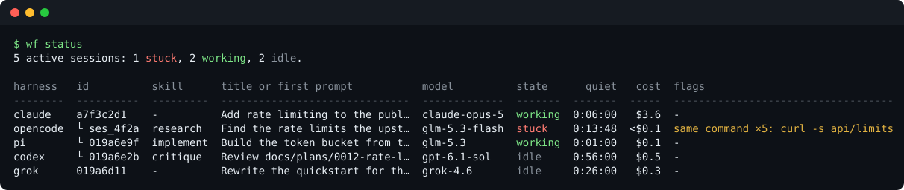
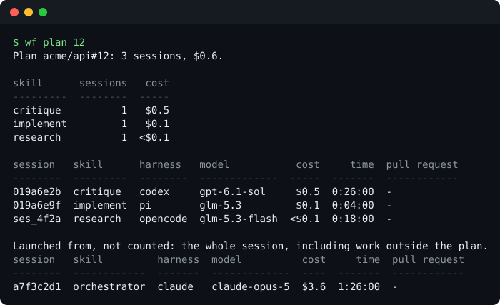
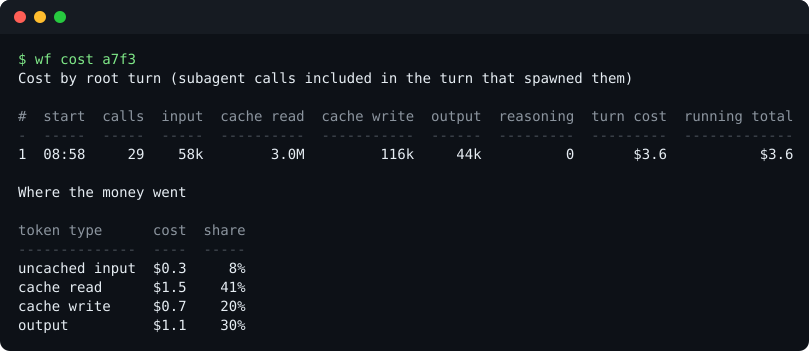
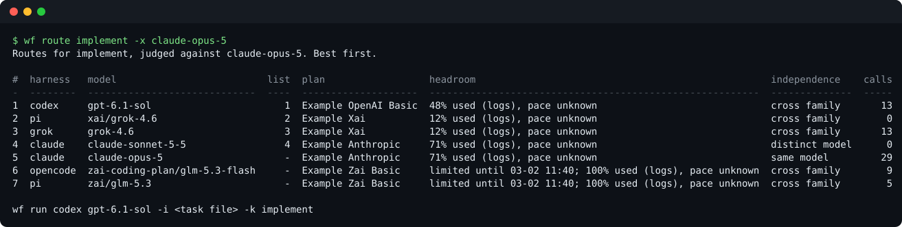
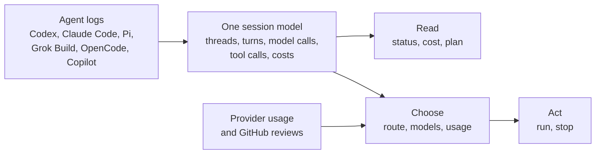

# Workflow

`wf` reads the logs of six coding agents into one session model: Codex, Claude Code, Pi, Grok Build,
OpenCode and GitHub Copilot. It shows what is running, what it cost and which model to use next. It
launches and stops sessions in every harness except Copilot.



`wf status` lists live sessions with the sessions an orchestrator launched indented under it. A
session is stuck after 10 minutes without an event or 30 minutes in one tool. A flag names the
pattern.

## Ask it

**What did plan 12 cost?** Every launched session carries its skill and plan.



**Where did the money go?**



**Which model should build next?** Your preferred list sets the order. Exhausted plans and the model
that wrote the work move to the bottom. The last line is the command that launches the first route.



The images are real `wf` output over invented sessions. `npm run showcase` regenerates them.

## How it works



## Install

```sh
git clone https://github.com/pepdevs/workflow.git && cd workflow
npm ci && npm run setup
wf help
```

Node.js 24 or newer. [Install and configure](docs/install.md) covers local catalogs, storage and
checks.

## Delegate skill

[`skills/delegate`](skills/delegate/SKILL.md) teaches an agent to route, launch, watch and check
sessions through `wf`. Install it with the [Skills CLI](https://github.com/vercel-labs/skills), and
its companions from [pepdevs/skills](https://github.com/pepdevs/skills):

```sh
npx --yes skills@1.7.2 add pepdevs/workflow --skill delegate --agent codex --global --copy --yes
```

## More

- [Use cases](docs/use-cases.md): each question, the command that answers it, and its output.
- [Configuration](docs/configuration.md): prices, plans, routes and repositories.
- [Fixtures](docs/fixtures.md): how the test logs were redacted.
- [SYSTEM.md](SYSTEM.md) maps the code. [AGENTS.md](AGENTS.md) holds the editing rules.

[MIT](LICENSE)
